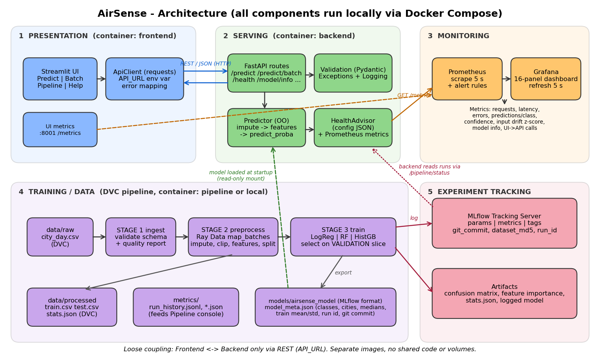

# AirSense - Architecture Diagram & Block Explanation

*(Source: `make_diagram.py`. The DVC pipeline DAG is in `dvc_dag.txt` / `dvc_dag.mmd`.)*

## Block-by-block

### 1. Presentation (container `frontend`, port 8501)
| Block | Responsibility |
|---|---|
| **Streamlit UI** | Four pages: *Predict* (single city), *Batch (CSV)*, *Pipeline* (ML-pipeline console), *Help* (user manual). Contains no model, data or ML code. |
| **ApiClient** | The *only* module that talks to the backend. Reads `API_URL` from the environment, applies timeouts, turns HTTP/connection failures into two typed exceptions (`ApiError`, `ApiUnavailable`) that the UI converts into plain-language messages. |
| **UI metrics** | Prometheus endpoint on :8001: page views, predict/batch outcomes, UI→API call outcomes and latency. |

### 2. Serving (container `backend`, port 8000)
| Block | Responsibility |
|---|---|
| **FastAPI routes** | REST contract (see LLD). Auto-generated OpenAPI docs at `/docs`. |
| **Validation + Exceptions + Logging** | Pydantic schemas reject bad input (422); domain exceptions map to clean JSON errors; a catch-all handler guarantees no stack trace ever reaches a client; rotating-file + console logs. |
| **Predictor (OO)** | Loads the MLflow-format model once; per request: validate city → impute blanks from per-city training medians → engineer features (shared code with training) → `predict_proba` → category + confidence. |
| **HealthAdvisor** | Category → colour + guidance from `health_advice.json` (editable without code changes). |
| **Prometheus metrics** | Request count/latency, errors by type, predictions per class, confidence, raw-input histograms, **drift z-score**, model info. |

### 3. Monitoring
**Prometheus** scrapes backend (:8000/metrics) and frontend (:8001) every 5 s and evaluates 5 alert rules (model not loaded, 5xx-class errors, p95 latency > 300 ms, input drift > 0.5 training std, backend down). **Grafana** auto-provisions a 16-panel dashboard refreshing every 5 s (near-real-time).

### 4. Training / data (DVC pipeline; Ray inside stage 2)
| Stage | What it does | Outputs |
|---|---|---|
| **ingest** | Reads the user's real `data/raw/city_day.csv` if present (never modified), else generates a labelled synthetic stand-in; validates schema and quality | `data/interim/city_day.csv`, `metrics/data_quality.json` |
| **preprocess** | **Ray Data** `map_batches`: negatives→missing, per-city median imputation, outlier clipping, feature engineering, **time-based** train/test split. Statistics are fitted on the training period only | `data/processed/*`, `metrics/pipeline_metrics.json` (throughput) |
| **train** | Trains LogReg / RandomForest / HistGradientBoosting, selects on a time-ordered validation slice, refits the winner, evaluates **once** on the later test period, exports the model | `models/airsense_model/` (MLflow format), `models/model_meta.json`, metrics, plots |

Every stage appends a success/failure record to `metrics/run_history.jsonl`, which powers the Pipeline console.

### 5. Experiment tracking
**MLflow** records parameters, metrics (validation and test), tags (`git_commit`, `dataset_md5`, `data_source`, `role`) and artifacts (confusion matrix, permutation feature importance, classification report, `stats.json`, the model). Candidate runs and the final run are separate, so model selection is auditable.

## Key interfaces
| Between | Mechanism |
|---|---|
| Frontend ⇄ Backend | **HTTP/JSON only**, address from `API_URL`. No shared code, no shared volume. |
| Pipeline → Backend | Files produced by `dvc repro` (`models/`, `metrics/`, `dvc.yaml`), mounted **read-only** into the backend container. |
| Backend → MLflow | HTTP (`MLFLOW_TRACKING_URI`) for the run table on the Pipeline page. |
| Prometheus → apps | Pull over HTTP (`/metrics`). |
