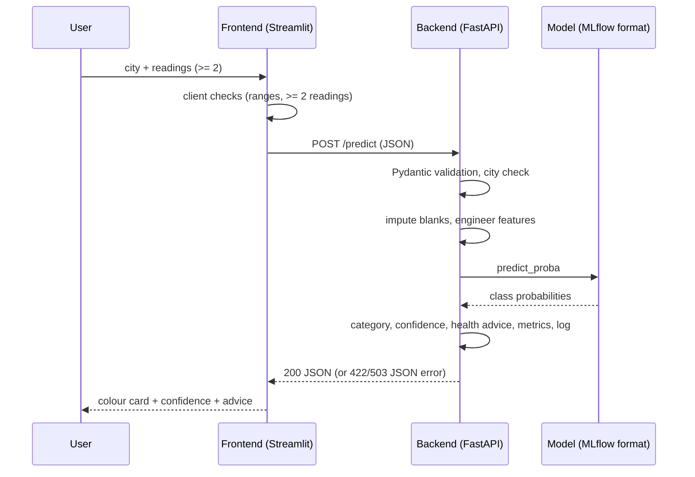

# AirSense - High-Level Design (HLD)

## 1. Problem and goals
Non-technical users want to know *how bad the air is in their city and what to do*. Raw pollutant numbers (PM2.5, PM10, NO2, SO2, CO, O3) are meaningless to them. AirSense maps readings to one of six CPCB categories - **Good, Satisfactory, Moderate, Poor, Very Poor, Severe** - with a confidence score and health guidance.

| Goal | Measurable success criterion |
|---|---|
| Accurate on *future* data | Macro-F1 ≥ 0.80 on a later-in-time test set (**achieved 0.964**) |
| No class ignored (Severe is rare) | Every class recall ≥ 0.70 (**min 0.938**) |
| Responsive | p95 `/predict` < 300 ms (**≈ 30-80 ms** across runs, measured through the test client) |
| Foolproof | Malformed input never yields a 5xx |
| Operable | Pipeline runs, failures, throughput, drift and latency all visible in UIs |
| Reproducible | Any model traceable to a Git commit hash + MLflow run ID + dataset hash |

## 2. Data
* **Source:** CPCB-derived Kaggle dataset *Air Quality Data in India (2015-2020)*, `city_day.csv`: daily city readings with `AQI_Bucket` label.
* **Known biases/limits (to document honestly):** uneven city coverage and time spans; substantial missing pollutant values (varies by pollutant and city - check `metrics/data_quality.json` after ingest); sensor outages; 2015-2020 only (pre-/post-COVID regime shifts); CO is mg/m³ whereas the rest are µg/m³.
* **Offline fallback:** the repo ships a *synthetic* generator with the same schema so the stack is runnable without internet. **Models trained on it are for demonstration only** - the UI shows a warning banner when `data_source = synthetic`. Put the real `city_day.csv` in `data/raw/` and run `dvc repro` (DVC detects the new input); no code change is required.
* **Important modelling caveat (measured):** the official AQI is a deterministic function (max of sub-indices) of these same pollutants. In `02_Pipeline_and_Training.ipynb` we apply the CPCB formula directly to the same imputed inputs: on the synthetic demo data it scores **exactly the same accuracy (0.9576) as the trained model**, so the model adds **no predictive value over the rule there** (expected: the synthetic labels *are* that formula). High accuracy is therefore not evidence of forecasting skill. What the system does provide is a calibrated confidence score (accuracy rises from ~55 % in the 0.5-0.6 confidence band to ~99 % above 0.95), a single API for single/batch use, and a retrainable pipeline. Whether a learned model beats the formula on the **real** Kaggle labels (which follow CPCB's fuller averaging procedure) must be measured by re-running the notebook on real data.

## 3. Design choices and rationale
| Decision | Choice | Rationale / trade-off |
|---|---|---|
| Split | **Time-based** (train < 2019-07-01 ≤ test) + a time-ordered validation slice inside train | Random splits leak seasonality and neighbouring days; we are asked to predict unseen future readings. |
| Leakage control | Imputation medians and clip caps fitted on the training period only, saved to `stats.json`, reused at inference | Identical transformation in training and serving; no test information in preprocessing. |
| Model selection | Selected on **validation**, test touched once | Avoids optimistic bias from picking the best of 3 models on the test set. |
| Candidates | LogReg (baseline), RandomForest, HistGradientBoosting | Baseline shows the value of non-linear models (val macro-F1 0.78 vs 0.96/0.95). XGBoost deliberately omitted: HistGB is equivalent for this size and removes a heavy dependency. |
| Imbalance | `class_weight="balanced"` + macro-F1 + per-class recall as the gate | Severe is the rarest class (3.3 % of the demo data); accuracy alone would hide failures. |
| Confidence | Max of `predict_proba`; <60 % shows a warning | Honest uncertainty for non-technical users. |
| Missing inputs | Allowed (≥ 2 readings), imputed with per-city medians and *reported back* | Real users rarely have all six readings; transparency about what was assumed. |
| Data engineering | **Ray Data** (`map_batches`) inside a DVC stage | Required engine; lighter than Spark on a laptop; scales to multi-core with `ray_num_cpus`. At 18 k rows Ray start-up dominates, which is reported in the throughput metrics. |
| Orchestration / CI | **DVC** DAG (`dvc repro`), `ci.sh` | DVC re-runs only stages whose code/params/data changed; `dvc.lock` pins hashes. |
| Tracking | **MLflow** (SQLite locally, server in Compose) | Params, metrics, tags, artifacts; run ID + Git hash = reproducibility. |
| Packaging | MLflow model format + FastAPI; `MLproject` + `conda.yaml` + Dockerfiles | Same pinned versions in dev/test/prod. |
| Serving API | **FastAPI** + Pydantic | Typed contract, auto OpenAPI, input validation by construction. |
| Loose coupling | UI and backend are separate images; only `API_URL` over REST | Either side can be replaced/scaled independently (e.g. a React UI later). |
| Monitoring | Prometheus + Grafana, both services instrumented, drift gauge | Detects outages, slowness, errors and *input distribution shift* (retrain trigger). |
| UI | Streamlit | Fastest route to a clean, responsive, accessible UI for a 4-page app; React rejected as unnecessary effort for the rubric's UX goals. |
| No cloud | Everything local in Docker Compose | Project constraint. |

## 4. Runtime flow (single prediction)

## 5. Training / delivery flow
`city_day.csv` → **ingest** (validate) → **preprocess** (Ray) → **train** (MLflow) → `models/` → mounted read-only into the backend → served. `dvc repro` runs the chain; `dvc dag` shows it; `metrics/run_history.jsonl` records outcomes; the **Pipeline** page visualises all of it.

## 6. Monitoring and maintenance
* **Drift:** the backend keeps a rolling window (last 200 values) of each user-supplied pollutant and exports `(rolling mean − training mean) / training std`. The `InputDrift` alert fires at |z| > 1 for 2 min (the mean moved by a full training standard deviation; an initial threshold of 3 proved far too insensitive in `04_Drift_Demo.ipynb`) → investigate/retrain (`dvc repro` with fresh data).
* **Rollback:** models are versioned by DVC (`dvc.lock` + `git checkout <commit> && dvc checkout`); Docker images can be re-built from any commit.
* **Limitation:** monitoring of *model accuracy* in production needs ground-truth labels, which arrive later and are not collected by this app; only input drift and confidence are monitored.

## 7. Security and privacy
* No personal data is collected; readings are not stored.
* Upload limits (5 MB, 5 000 rows), strict schemas, no code execution on user input, generic 500 messages.
* The model file uses cloudpickle (MLflow 3's default `skops` format rejects tree models); it is only ever loaded from a **trusted, read-only mount** produced by our own pipeline. Never load third-party model files this way.
* **Not implemented (out of scope for a local demo):** TLS and authentication. Deploy behind a TLS-terminating reverse proxy for any shared use; Grafana runs with anonymous *viewer* access for the demo (admin password is `admin` - change it).

## 8. Explainability
Permutation feature importance on the test set (`metrics/feature_importance.csv`, logged to MLflow): PM10 and PM2.5 dominate, which matches how CPCB AQI is defined - a useful sanity check. The UI also shows the full probability breakdown per class.

## 9. Risks and mitigations
| Risk | Mitigation |
|---|---|
| Training on synthetic data mistaken for real | Banner in UI, `data_source` tag on every MLflow run, documented here |
| Unit confusion (CO in mg/m³) | Units in every label, help text, enforced range (≤ 100) |
| Rare-class failures | Per-class recall acceptance gate |
| Pipeline silently failing | Run history with tracebacks, DAG node colours, Prometheus alerts |
| Frontend/backend drift | OpenAPI contract + client error mapping + tests with mocked and live backend |
